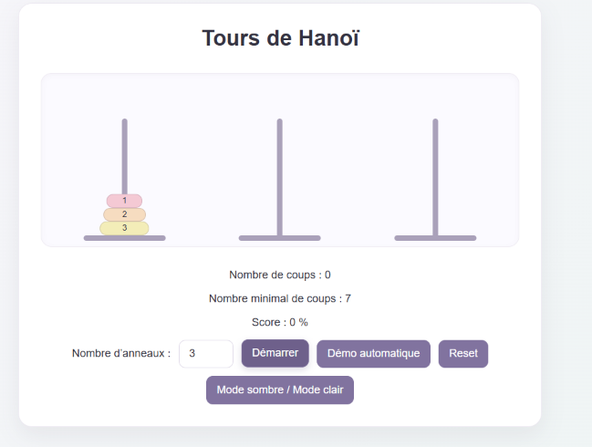
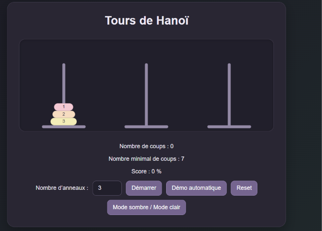
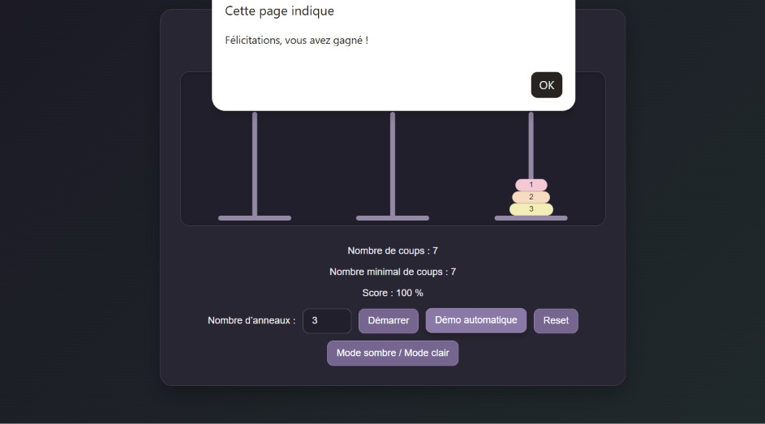
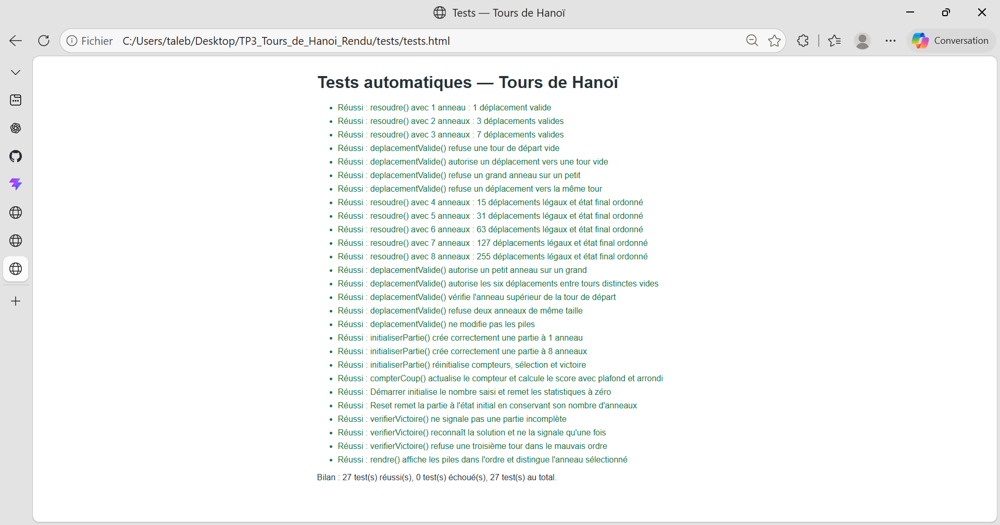

# TP3 — No-code & Low-code : Tours de Hanoï

**[Jouer au jeu](https://talebwissame.github.io/Towers-of-hanoi-llm/)**

Le jeu sera accessible via ce lien apres activation de GitHub Pages dans ce depot.


## Présentation du projet

Ce projet présente un jeu des Tours de Hanoï réalisé dans le cadre du TP3 de No-code & Low-code en L2 Informatique. L’objectif est de créer un jeu utilisable directement dans un navigateur, puis d’étudier la génération de code par des assistants d’intelligence artificielle et de documenter et tester le code JavaScript.

## Technologies utilisées

- HTML5 pour la structure de la page ;
- CSS3 pour la mise en forme et les animations ;
- JavaScript pour les règles et le fonctionnement du jeu ;
- GitHub Copilot pour accompagner la réalisation.

## Fonctionnalités du jeu

- Déplacements manuels des anneaux, avec vérification des règles ;
- Démonstration automatique basée sur l’algorithme récursif des Tours de Hanoï ;
- Compteur de coups et calcul du score ;
- Détection et annonce de la victoire ;
- Bouton Reset pour recommencer la partie ;
- Animations des déplacements ;
- Mode clair et mode sombre.

## Organisation des fichiers

```text
TP3_Tours_de_Hanoi_Rendu/
|-- index.html                     # Redirection vers hanoi/
|-- .nojekyll                      # Publication statique sans Jekyll
|-- README.md
|-- prompts.md
|-- prompt-final.md
|-- compte-rendu.md
|-- analyse.md
|-- hanoi/                         # Jeu principal
|   |-- index.html
|   |-- style.css
|   `-- script.js
|-- tests/                         # Tests automatiques
|   |-- tests.html
|   `-- tests.js
|-- exercice-7/
|   |-- copilot/                   # Version GitHub Copilot
|   |   |-- index.html
|   |   |-- style.css
|   |   `-- script.js
|   |-- claude/                    # Version Claude
|   |   |-- index.html
|   |   |-- style.css
|   |   `-- script.js
|   `-- prompt-sans-architecture.md # Experience d'ablation
`-- captures/                      # Captures du jeu et des tests
    |-- jeu-clair.png
    |-- jeu-sombre.png
    |-- victoire.png
    `-- tests.png
```

Documents du rendu :

- [`prompts.md`](prompts.md) : journal des prompts et des vérifications ;
- [`prompt-final.md`](prompt-final.md) : prompt unique et tableau comparatif entre GitHub Copilot et Claude ;
- [`compte-rendu.md`](compte-rendu.md) : bilan de l’exercice 7 ;
- [`analyse.md`](analyse.md) : analyse personnelle d’environ dix lignes ;
- [`exercice-7/prompt-sans-architecture.md`](exercice-7/prompt-sans-architecture.md) : prompt de l’expérience d’ablation, sans la section d’architecture obligatoire.

## Lancer le jeu et les tests

1. Pour jouer, ouvrir le dossier `hanoi/` et double-cliquer sur [`index.html`](hanoi/index.html), ou utiliser « Ouvrir avec » pour choisir un navigateur.
2. Pour lancer les tests automatiques, ouvrir le dossier `tests/` et double-cliquer sur [`tests.html`](tests/tests.html), ou utiliser « Ouvrir avec » pour choisir un navigateur. Le bilan s’affiche dans la page.

Les deux pages s’ouvrent directement dans le navigateur, sans serveur ni installation. En cas d’affichage d’une ancienne version, actualiser la page avec `Ctrl + F5`.

## Captures d’écran

Aperçu de l’interface et de la page de tests. Cliquer sur une capture pour l’afficher en grand.

| Mode clair | Mode sombre |
| :---: | :---: |
| [](captures/jeu-clair.png) | [](captures/jeu-sombre.png) |

| Victoire | Tests automatiques |
| :---: | :---: |
| [](captures/victoire.png) | [](captures/tests.png) |

## Exercice 7 — Comparaison entre GitHub Copilot et Claude

Cet exercice compare le jeu généré par GitHub Copilot à celui généré par Claude, initialement utilisé via use.ai. Le compte-rendu présente les différences observées, notamment en matière de taille du code et de méthode de développement.

Les versions comparées sont disponibles dans [`exercice-7/copilot/`](exercice-7/copilot/index.html) et [`exercice-7/claude/`](exercice-7/claude/index.html). Le prompt de l’expérience d’ablation est conservé dans [`prompt-sans-architecture.md`](exercice-7/prompt-sans-architecture.md).

Le prompt final est disponible dans [`prompt-final.md`](prompt-final.md) et la comparaison détaillée dans [`compte-rendu.md`](compte-rendu.md).

## Exercice 8 — JSDoc et tests automatiques

Les fonctions du jeu sont documentées avec des commentaires JSDoc. Des tests automatiques ont été préparés pour vérifier notamment l’algorithme `resoudre()` et la validation des déplacements. Lors de ma vérification dans le navigateur, j’ai obtenu **27 tests réussis et 0 échec**.

## Publication sur GitHub Pages

1. Utiliser le depot existant `TALEBWISSAME/Towers-of-hanoi-llm`, avec le contenu du rendu a la racine et tous ses sous-dossiers.
2. Dans le dépôt, ouvrir **Settings > Pages**.
3. Sous **Build and deployment > Source**, choisir **Deploy from a branch**.
4. Sous **Branch**, sélectionner la branche contenant les fichiers (par exemple `main`), puis **/ (root)** et cliquer sur **Save**.
5. Attendre la fin du déploiement. Consulter l’onglet **Actions** en cas d’erreur, puis revenir dans **Settings > Pages** pour copier l’adresse publiée.
6. Remplacer la destination `#publication-sur-github-pages` du lien **Jouer au jeu** en haut de ce README par l’adresse réelle copiée. La page d’accueil redirige automatiquement vers `hanoi/` ; on peut aussi utiliser l’adresse du site suivie de `hanoi/`.
7. Vérifier le jeu en ligne, ses styles et ses interactions. Ouvrir aussi `tests/tests.html` sous l’adresse du site pour vérifier les tests publiés.

Adresse prevue : `https://talebwissame.github.io/Towers-of-hanoi-llm/`. Confirmer cette adresse dans les parametres Pages apres activation.

Les chemins du jeu (`style.css`, `script.js`), des tests (`../hanoi/script.js`, `tests.js`) et des captures sont relatifs : ils conservent le préfixe du dépôt sur GitHub Pages. Le jeu principal reste dans `hanoi/`.

Procédure de référence : [documentation officielle GitHub Pages](https://docs.github.com/en/pages/getting-started-with-github-pages/configuring-a-publishing-source-for-your-github-pages-site).
